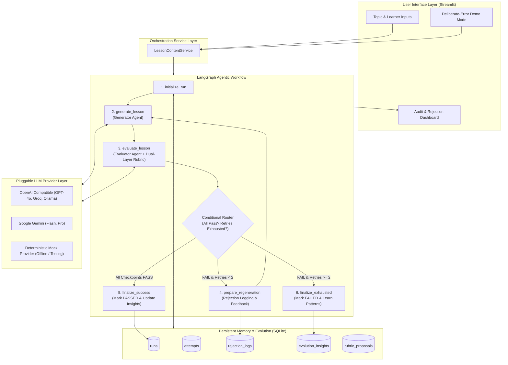

# System Architecture & Component Design

## 1. Executive Summary

The **Self-Evaluating Lesson Content Generator** is an enterprise-grade agentic AI application designed for educational content generation and strict automated pedagogical auditing. Rather than relying on simple one-shot LLM prompts, the application is built on an **autonomous feedback loop** orchestrated via **LangGraph**, backed by **Pydantic v2** structured validation, an **independent evaluator agent**, a **dual-layer rubric engine**, and **persistent SQLite memory** with controlled **self-evolution**.

---

## 2. High-Level Architecture Diagram

---

## 3. Modular System Components

### 3.1. User Input Component (`app.py`)
- Accepts educational topic (assigned topic: *"Introduction to RAG"*).
- Configures target learner persona (Indian 12th-grade graduate with non-English medium background and no AI knowledge).
- Provides deliberate-error demonstration toggle with configurable failure injections (flawed embeddings, missing vector DB, jargon overload, flawed workflow).

### 3.2. Lesson Generator Agent (`agents/generator.py`)
- Produces structured `LessonContent` covering all **18 mandatory syllabus components**.
- Applies cultural and pedagogical grounding tailored to the learner:
  - Simple conversational English with short sentences.
  - Everyday Indian analogies (Ramesh Uncle's Kirana shop Bahi-Khata ledger, CBSE open-book exam vs closed-book exam).
  - Immediate plain-English definitions upon first introduction of technical words.
- Feedback-aware: Ingests specific failure reasons from rejected attempts and performs targeted fixes without regressing passed sections.
- Dynamically ingests historical self-evolution insights to pre-emptively avoid known quality pitfalls.

### 3.3. Dual-Layer Rubric Engine (`evaluation/rubric.py`)
- Implements strict **PASS/FAIL** auditing across 6 core dimensions:
  1. *Accuracy and Grounding*
  2. *Beginner-Friendly Language*
  3. *Teaching Through Examples*
  4. *Clarity and Jargon*
  5. *Topic Coverage (all 18 sections)*
  6. *Teaching Flow*
- **Layer 1: Deterministic Audits**:
  - Programmatic verification of all 18 mandatory sections and minimum content lengths.
  - Vocabulary screening against a blacklist of unexplained advanced machine learning jargon (`eigenvalues`, `high-dimensional manifold`, `cross-entropy loss`, etc.).
  - Glossary check (at least 4 terms defined in simple everyday terms).
  - Assessment check (at least 3 knowledge-check questions with answers and explanations).
- **Layer 2: Semantic LLM Audits**:
  - Deep conceptual accuracy, grounding, Indian student appropriateness, analogy validity, and hallucination absence.
- **Strict Rule**: No partial credit. If any mandatory checkpoint fails, the entire attempt is marked `FAIL`.

### 3.4. Lesson Evaluator Agent (`agents/evaluator.py`)
- Evaluates the generated lesson **independently**.
- Never asks the generator to evaluate its own output.
- Enforces concrete quote/evidence extraction for every checkpoint verdict.
- Formulates actionable suggested improvements for every failed checkpoint.

### 3.5. Conditional Router & Regeneration Loop (`workflow/nodes.py`)
- Governed by LangGraph's typed state (`LessonState`).
- Decides next stage based on evaluation verdict and retry count:
  - If 100% checkpoints pass $\rightarrow$ route to `finalize_success`.
  - If any checkpoint fails and `current_attempt <= max_retries` $\rightarrow$ route to `prepare_regeneration`.
  - If retries exhausted (attempts reaching $1 + \text{max\_retries}$) $\rightarrow$ route to `finalize_exhausted`.
- Maximum retries: 2 (at most 3 attempts total). Guaranteed termination with zero infinite loops.

### 3.6. Persistent SQLite Memory (`memory/database.py`, `memory/repository.py`)
- Genuinely persistent database (`data/lesson_generator.db`) that survives application restarts.
- Maintains schema for runs, attempts, evaluation reports, and rejection trails.
- Segregates runs by topic keywords to prevent cross-topic feedback contamination.

### 3.7. Self-Evolution Engine (`memory/evolution.py`)
- Analyzes repeated evaluation failure patterns across multiple runs.
- Derives versioned `SelfEvolutionInsight` rules (e.g., proactive embedding analogies, jargon avoidance).
- Pre-emptively supplies active insights to future generator prompts.
- **Safety Governance**: Core rubric standards are frozen. Rubric evolution must be submitted as versioned, reviewable proposals (`rubric_proposals`) to prevent automatic quality degradation or gaming.

### 3.8. Configurable LLM Provider Layer (`services/llm_service.py`)
- Clean abstract base class `BaseLLMProvider`.
- Pluggable implementations:
  - `DeterministicMockLLMProvider`: Instant, offline, zero-key simulation mode.
  - `OpenAICompatibleProvider`: Supports OpenAI (`gpt-4o`, `gpt-4o-mini`), Groq (`llama-3.3-70b-versatile`), and Ollama.
  - `GeminiProvider`: Supports Google Gemini (`gemini-1.5-flash`, `gemini-1.5-pro`).
- Enforces strict Pydantic JSON extraction and regex parsing.

---

## 4. Data Flow & State Lifecycle

| Stage | Node Name | Input State | Output Mutations | DB Action |
| :--- | :--- | :--- | :--- | :--- |
| **1. Init** | `initialize_run` | `topic`, `audience`, `max_retries` | `run_id`, `current_attempt=1`, `insights_applied` | Inserts into `runs` table |
| **2. Generate** | `generate_lesson` | `current_attempt`, `feedback_history`, `insights` | `generated_lesson: LessonContent` | None (in-memory) |
| **3. Audit** | `evaluate_lesson` | `generated_lesson`, `audience` | `evaluation_result: EvaluationReport` | Inserts into `attempts` table |
| **4. Route** | `decision_router` | `evaluation_result`, `current_attempt` | Target node name string | None |
| **5a. Re-queue**| `prepare_regeneration`| `evaluation_result`, `rejection_log` | `current_attempt++`, `rejection_log++`, `feedback_history++` | Inserts into `rejection_logs` table |
| **5b. Passed** | `finalize_success` | `generated_lesson`, `run_id` | `final_status="PASSED"`, `final_lesson_markdown` | Updates `runs` (PASSED) |
| **5c. Depleted**| `finalize_exhausted` | `evaluation_result`, `run_id` | `final_status="FAILED"`, `final_lesson_markdown` | Updates `runs` (FAILED), registers learned failure |
